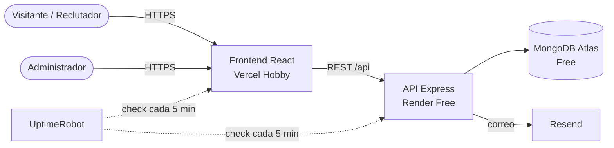

# SLA, SLO, SLI y Error Budget — `sebastiancarrera.dev`
 
**Autor:** Sebastián Carrera Medina
**Curso:** Micromáster · Módulos 1.3 y 1.4 — Arquitectura ágil, DevOps y diseño end-to-end
**Sistema evaluado:** portafolio personal `sebastiancarrera.dev` (aplicación MERN)
 
---
 
## 1. Definiciones
 
| Término | Qué es | En este documento |
|---|---|---|
| **SLI** (Service Level Indicator) | Métrica concreta y medible, normalmente una proporción `eventos buenos / eventos válidos`. | "% de checks HTTP al sitio que responden 200 con el contenido esperado". |
| **SLO** (Service Level Objective) | Meta interna para un SLI en una ventana de tiempo. La fija el equipo. | "SLI de disponibilidad ≥ 99,5 % en 30 días". |
| **SLA** (Service Level Agreement) | Compromiso externo con el usuario, con consecuencias si se incumple. Siempre más laxo que el SLO para dejar margen. | "Disponibilidad mensual ≥ 99,0 %". |
| **Error budget** | `1 − SLO`: cuánto fallo es aceptable. Cuando se agota, se prioriza estabilidad sobre funcionalidades nuevas. | 0,5 % de 30 días = 216 min/mes. |
 
Relación: **el SLI mide → el SLO fija la meta interna → el SLA es la promesa externa (más laxa) → el error budget es lo que queda entre el 100 % y el SLO.**
 
---
 
## 2. Contexto del sistema en producción
 
| Componente | Tecnología | Hosting (plan) |
|---|---|---|
| Frontend | React + Vite (SPA bilingüe ES/EN) | Vercel — Hobby (gratuito), `frontend/vercel.json` |
| API | Node.js + Express | Render — Free web service, `render.yaml` (`sebastiancarrera-api`) |
| Base de datos | MongoDB | MongoDB Atlas — Free cluster |
| Correo de contacto | Resend | Plan gratuito |
| Autenticación admin | JWT en cookie `httpOnly` | — |
 
Funcionalidades: catálogo de proyectos administrable (CMS bilingüe), formulario de contacto que envía correo y panel privado de administración.
 
### 2.1 Restricciones que condicionan los objetivos
 
1. **Costo $0 es una restricción no negociable.** Ningún proveedor ofrece SLA en sus planes gratuitos: el SLA de Vercel es del plan Enterprise, y Atlas solo lo da en clusters dedicados. Por eso **el SLO del portafolio no puede apoyarse en garantías contractuales de terceros** y tiene que ser conservador.
2. **Render Free apaga el servicio tras 15 minutos sin tráfico.** La siguiente petición sufre un *cold start* de decenas de segundos. Para un visitante, ese primer request lento es indistinguible de una caída. *Táctica ya implementada:* al cargar, el frontend hace un `fetch` a `/api/health` (`frontend/src/main.jsx`) para despertar la API mientras se renderiza la SPA. Eso reduce el cold start percibido, pero no lo elimina.
3. **Render Free da 750 horas de instancia al mes por workspace.** Si se agotan, suspende todos los servicios gratuitos hasta el mes siguiente. Un servicio despierto 24/7 consume 720 h (30 días) o 744 h (31 días): **cabe, pero solo si es el único servicio gratuito del workspace.**
4. **Render puede reiniciar un servicio gratuito en cualquier momento**, así que aun manteniéndolo despierto habrá cold starts ocasionales.
5. **Tráfico bajo.** Un portafolio recibe pocas visitas, y con pocos eventos un SLI basado solo en tráfico real es muy ruidoso (un request fallido de 50 es un 2 %). Por eso la disponibilidad se mide con **checks sintéticos**, que generan un volumen constante y predecible.
### 2.2 Atributos de calidad que guían los supuestos
 
- **Disponibilidad:** el sitio es la carta de presentación ante reclutadores, y un visitante que encuentra el sitio caído normalmente no vuelve.
- **Rendimiento (latencia percibida):** un cold start de 30 s se percibe como sitio roto.
- **Fiabilidad del contacto:** un mensaje perdido es una oportunidad perdida. Es el único flujo que genera valor directo.
- **Seguridad:** el panel admin está protegido con JWT. No se trata como journey crítico de disponibilidad porque lo usa una sola persona.
---
 
## 3. User journeys críticos
 
Siguiendo el proceso de la sesión (identificar journeys → SLI → SLO → implementación → política):
 
| # | Journey | Criticidad | Por qué |
|---|---|---|---|
| **J1** | Visitante abre el sitio y ve la lista de proyectos | **Alta** | Es la razón de ser del portafolio. |
| **J2** | Visitante envía un mensaje por el formulario de contacto | **Alta** | Es el único flujo que convierte una visita en oportunidad. |
| **J3** | Administrador inicia sesión y edita proyectos | Baja | Un solo usuario, que puede reintentar más tarde sin perder nada. |
 
---
 
## 4. SLIs
 
Se cuentan como **eventos válidos** los requests y checks bien formados. Las respuestas 4xx causadas por el cliente (validación, rate limiting, credenciales incorrectas) no cuentan como fallos del servicio.
 
| ID | Journey | SLI (fórmula) | Fuente de datos |
|---|---|---|---|
| **SLI-1** | J1 | **Disponibilidad:** `checks exitosos / checks totales`. Un check es exitoso si `GET https://sebastiancarrera.dev` devuelve 200 con una palabra clave esperada **y** `GET /api/health` devuelve 200 con un `ping` exitoso a MongoDB (ver 8.1). | UptimeRobot, cada 5 min → 8.640 checks en 30 días |
| **SLI-2** | J1 | **Latencia:** `requests a GET /api/projects con duration_ms < 1000 / requests válidos a GET /api/projects` | Logs estructurados de Express (campo `duration_ms`) |
| **SLI-3** | J2 | **Éxito del contacto:** `respuestas 201 (mensaje guardado en MongoDB) / envíos válidos a POST /api/contact`. Los 400 de `express-validator` y los 429 de `contactLimiter` no cuentan como envíos válidos. | Logs estructurados (ver 8.2) |
| **SLI-4** | J3 | **Disponibilidad del login:** `respuestas a POST /api/auth/login sin 5xx / requests válidos` | Logs estructurados |
 
> El SLI-1 incluye `/api/health` porque el frontend (Vercel) puede estar arriba mientras la API (Render) o la base de datos (Atlas) están caídas. En ese caso el visitante vería un portafolio vacío, y eso también es un fallo de J1.
 
---
 
## 5. SLOs
 
Ventana: **30 días móviles**, salvo SLO-3, que usa 90 días por el bajo volumen de mensajes.
 
| ID | SLO | Justificación |
|---|---|---|
| **SLO-1** | SLI-1 ≥ **99,5 %** | Se encadenan tres dependencias gratuitas sin SLA (Vercel → Render → Atlas), y la disponibilidad compuesta es menor que la de cada una. Un 99,9 % no sería defendible sin pagar por las dependencias. |
| **SLO-2** | SLI-2 ≥ **95 %** | Los cold starts por reinicio son inevitables en Render Free. Se aceptan siempre que no pasen del 5 % de los requests. |
| **SLO-3** | SLI-3 ≥ **99 %** (ventana 90 días) | Es el flujo de más valor. `contactController.sendMessage` ya guarda el mensaje en MongoDB **antes** de notificar por correo con Resend. Si Resend falla, el error se registra, el visitante igual recibe 201 y el mensaje queda en la bandeja del panel admin. Por eso el SLI mide la persistencia y no el correo: la notificación por correo es un aviso, no el journey. |
| **SLO-4** | SLI-4 ≥ **99 %** | Flujo interno de un solo usuario. Tiene objetivo, pero sin política estricta. |
 
---
 
## 6. SLA
 
El "cliente" del portafolio es el visitante (reclutador o posible contratante), que no paga. Por eso el SLA **no puede ofrecer compensación económica**: sus consecuencias son de transparencia y de canal alternativo.
 
| Compromiso | Valor |
|---|---|
| Disponibilidad mensual del sitio (medida con SLI-1) | **≥ 99,0 %** (máx. ~7 h 12 min de caída al mes) |
| Respuesta a mensajes de contacto | ≤ 48 horas hábiles |
| Si se incumple | Página de estado pública (UptimeRobot) con el incidente, y un correo alternativo visible en el sitio y en el README del repositorio |
 
**Margen SLA vs. SLO:** el SLA (99,0 %) es 0,5 puntos más laxo que el SLO interno (99,5 %). Eso deja unas 3,6 h al mes para detectar y corregir un problema antes de romper el compromiso externo.
 
**Límite de este SLA:** como las dependencias gratuitas no dan SLA, este compromiso es de buena fe y no puede respaldarse con contratos. Para ofrecer un SLA respaldado habría que pasar la API a una instancia paga de Render (sin spin-down) y usar planes de Atlas y Vercel con SLA. Eso choca con la restricción de costo $0.
 
---
 
## 7. Error budget
 
### 7.1 Cálculo (mes de 30 días = 43.200 min)
 
| SLO | Error budget | En tiempo | En eventos |
|---|---|---|---|
| SLO-1: 99,5 % | 0,5 % | **216 min (3 h 36 min)** | 43 de 8.640 checks |
| SLO-2: 95 % | 5 % | — | 5 de cada 100 requests a `/api/projects` |
| SLO-3: 99 % (90 días) | 1 % | — | Con poco volumen: **máx. 1 mensaje fallido por trimestre** |
| SLO-4: 99 % | 1 % | 432 min (7 h 12 min) | — |
 
Nota de precisión: con checks cada 5 minutos, la resolución de SLI-1 es de 5 minutos. Una caída de 30 segundos puede no detectarse, y una de 6 minutos puede contarse como 10.
 
### 7.2 Política de error budget (aplica a SLO-1 y SLO-3)
 
| Budget restante en la ventana | Acción |
|---|---|
| **> 50 %** | Desarrollo normal: se despliegan features cuando estén listas. |
| **25 – 50 %** | Cada despliegue requiere pruebas pasando y revisión manual del sitio en producción. Se revisa la causa de los fallos acumulados. |
| **< 25 %** | Solo se despliegan correcciones de estabilidad y seguridad. |
| **Agotado** | **Congelamiento de features** hasta que la ventana móvil recupere budget. Postmortem corto (qué pasó, causa, acción). Si la causa es estructural (spin-down, horas de instancia), se evalúa pasar la API a una instancia paga. |
 
**Alerta temprana:** si en un solo día se consume más del 10 % del budget mensual de SLO-1 (≈ 22 min de caída), se investiga ese mismo día sin esperar a que se agote.
 
---
 
## 8. Implementación de los SLIs (stack de observabilidad, costo $0)
 
| Pilar | Herramienta | Qué se implementa |
|---|---|---|
| **Métricas / sintético** | UptimeRobot (plan gratuito: hasta 50 monitores, intervalo de 5 min, página de estado pública) | Monitor de palabra clave en el frontend, monitor HTTP a `/api/health` y alertas por correo. **Efecto secundario útil:** un check cada 5 min mantiene la API despierta, porque es menos que los 15 min que provocan el spin-down. |
| **Logs** | Logs estructurados en JSON a `stdout`, visibles en el dashboard de Render | Cada request registra `timestamp`, `requestId`, `method`, `route`, `status` y `duration_ms` (middleware de 8.2). De aquí salen SLI-2, SLI-3 y SLI-4. El envío con Resend ya registra éxito (`Email enviado OK`) y error (`Resend error`). |
| **Trazas** | Correlación por `requestId` en los logs | La API es un monolito con una sola base de datos, así que no hace falta trazabilidad distribuida completa. Si el sistema creciera a varios servicios, se instrumentaría con OpenTelemetry. |
 
### 8.0 Estado actual vs. cambios necesarios
 
| Elemento | Estado en el código actual | Cambio para producción |
|---|---|---|
| `/api/health` | Existe (`server.js`), pero responde `{status:"ok"}` sin consultar MongoDB | Agregar `ping` a la BD (8.1). Si no, SLI-1 reporta "arriba" con la BD caída. |
| Logs de requests | `morgan` solo corre fuera de producción, así que en producción no hay registro por request | Middleware de log estructurado (8.2) |
| Persistencia del contacto | Ya guarda en MongoDB antes del correo | Ninguno |
| Monitoreo sintético | No configurado | Crear los dos monitores en UptimeRobot |
 
### 8.1 Endpoint de salud
 
```js
// GET /api/health → 200 si la API y MongoDB responden; 503 si no
app.get('/api/health', async (req, res) => {
  try {
    await mongoose.connection.db.admin().ping();
    res.status(200).json({ status: 'ok' });
  } catch {
    res.status(503).json({ status: 'degraded' });
  }
});
```
 
### 8.2 Middleware de logs estructurados
 
```js
import { randomUUID } from 'node:crypto';
 
// Una línea JSON por request: la materia prima de SLI-2, SLI-3 y SLI-4
app.use((req, res, next) => {
  const start = process.hrtime.bigint();
  req.id = randomUUID();
  res.on('finish', () => {
    console.log(JSON.stringify({
      timestamp: new Date().toISOString(),
      requestId: req.id,
      method: req.method,
      route: req.baseUrl + (req.route?.path ?? ''),
      status: res.statusCode,
      duration_ms: Number(process.hrtime.bigint() - start) / 1e6,
    }));
  });
  next();
});
```
 
Ejemplo: SLI-2 = líneas con `route: "/api/projects/"`, `method: "GET"` y `duration_ms < 1000`, divididas por todas las líneas `GET` de esa misma ruta.
 
### 8.3 Riesgo operativo detectado
 
El monitor de UptimeRobot mantiene la API despierta 24/7, así que consume ~720–744 h de las 750 h gratuitas del workspace de Render. **Desplegar otro servicio gratuito en el mismo workspace** (por ejemplo, otra API) agotaría las horas y Render suspendería ambos servicios hasta fin de mes. Eso consumiría todo el error budget de golpe. **Decisión:** cada API gratuita va en su propio workspace de Render, o se pasa a plan pago.
 
---
 
## 9. Anexo (opcional): diagrama de contexto
 

 
